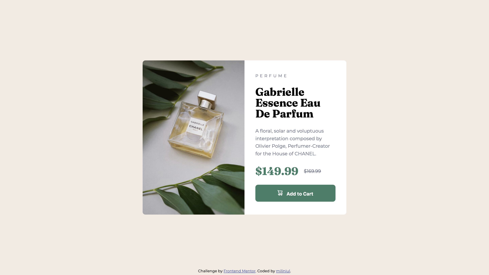

# Frontend Mentor - Product preview card solution

This is a solution to the [Product preview card component challenge on Frontend Mentor](https://www.frontendmentor.io/challenges/product-preview-card-component-GO7UmttRfa). Frontend Mentor challenges help you improve your coding skills by building realistic projects. 

## Table of contents

- [Overview](#overview)
  - [The challenge](#the-challenge)
  - [Screenshot](#screenshot)
  - [Links](#links)
- [My process](#my-process)
  - [Built with](#built-with)
  - [What I learned](#what-i-learned)
  - [Continued development](#continued-development)
  - [Useful resources](#useful-resources)
  - [AI Collaboration](#ai-collaboration)
- [Author](#author)

## Overview

### The challenge

Build a responsive product preview card that closely matches the provided mobile and desktop designs.

The most challenging part was switching between the mobile and desktop product images and sizing the image correctly on larger screens. On tablet and desktop, the image needed to occupy half of the card's width and fill its entire height.

I used the `<picture>` element with media-based sources to switch images at `640px`. For the larger-screen layout, I used CSS Grid with `grid-template-columns: 1fr 1fr` to divide the card into two equal columns. Setting the image to `width: 100%`, `height: 100%`, and `object-fit: cover` allowed it to fill its column while preserving its proportions and cropping when necessary.


### Screenshot




### Links

- Solution URL: [Product preview card](https://miliniul.github.io/product-preview-card/)

## My process

### Built with

- Semantic HTML5 markup
- CSS custom properties
- Flexbox
- CSS Grid
- Mobile-first workflow

### What I learned

I learned how to use the `<picture>` element to display different images depending on the viewport width. Instead of resizing the same image for every screen, I used separate mobile and desktop versions to match the composition of each design.

```html
<picture>
  <source
    media="(min-width: 640px)"
    srcset="images/image-product-desktop.jpg"
  >
  
</picture>
```

I also practiced combining CSS Grid with image sizing rules. Using `grid-template-columns: 1fr 1fr` gave the image and product details equal shares of the card's width. The image could then fill its column with `height: 100%` and `object-fit: cover`.

This helped me understand the difference between defining the layout and controlling how an image fits inside it: Grid determines the available space, while `object-fit` controls how the image fills that space.

### Continued development

My next step is to test how the two-column card handles longer product names and descriptions. I want to check whether the image continues to fill its half of the card as the text content makes the card taller.

I will test the layout just below and above the `640px` breakpoint, as well as at `200%` browser zoom. I will check for horizontal scrolling, clipped text, and excessive image cropping. Based on the results, I will adjust the breakpoint or image positioning so the product remains clearly visible and the content stays readable.

### Useful resources

- [Doka](https://doka.guide/) — A community-driven resource in Russian with clear explanations and practical examples of HTML, CSS, and JavaScript. Useful for understanding layout techniques and reviewing the basics.
- [MDN Web Docs](https://developer.mozilla.org/en-US/) — Comprehensive documentation and guides for web technologies. A helpful reference for checking syntax, exploring CSS properties, and learning JavaScript.

### AI Collaboration

I used Perplexity to find learning resources and explore HTML and CSS concepts while working on this project. It helped me understand Flexbox, how to add custom fonts, and how to manage spacing between elements.

I used it as a learning aid, testing the suggestions in my project to better understand how they worked.

## Author

- Frontend Mentor - [@miliniul](https://www.frontendmentor.io/profile/miliniul)